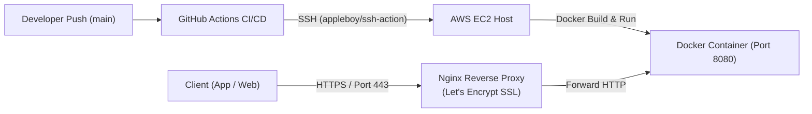

# 🚀 TOEIC Learning Platform — Backend RESTful API (.NET 9)

[](https://dotnet.microsoft.com/)
[](https://docs.microsoft.com/en-us/dotnet/csharp/)
[](https://blog.cleancoder.com/uncle-bob/2012/08/13/the-clean-architecture.html)
[](https://firebase.google.com/docs/firestore)
[](https://www.docker.com/)
[](https://aws.amazon.com/ec2/)
[](https://github.com/features/actions)

> Hệ thống máy chủ dịch vụ (Core Backend API) phục vụ nền tảng luyện thi TOEIC 4 kỹ năng đa nền tảng. Dự án được xây dựng theo mô hình **Clean Architecture** trên nền tảng **.NET 9**, tích hợp **Hybrid AI** (Google Gemini & OpenAI) chấm điểm tự động bài thi Nói/Viết, cơ chế kiểm soát đồng thời **SemaphoreSlim**, thuật toán học từ vựng **Spaced Repetition (SRS)** và tự động triển khai liên tục qua **GitHub Actions CI/CD** lên **AWS EC2**.

---

## 🌐 Hệ Sinh Thái Dự Án (Ecosystem Repositories)

Hệ thống được thiết kế theo kiến trúc Client-Server đồng bộ giữa 3 thành phần:

* 🚀 **Backend API (.NET 9):** [https://github.com/TranMinhTan3110/toeic-backend-api](https://github.com/TranMinhTan3110/toeic-backend-api) *(Repo này)*  
  *Core RESTful API, Business Logic, AI Evaluation, Firestore Data Layer, Docker, AWS EC2.*
* 📱 **Mobile Client (Flutter):** [https://github.com/TranMinhTan3110/toeic-mobile-app](https://github.com/TranMinhTan3110/toeic-mobile-app)  
  *Ứng dụng di động luyện thi 4 kỹ năng (Nghe, Đọc, Nói AI, Viết AI) và Flashcards SRS.*
* 💻 **Web Admin Portal (ReactJS):** [https://github.com/TranMinhTan3110/toeic-web-app](https://github.com/TranMinhTan3110/toeic-web-app)  
  *Trang web quản trị câu hỏi (QBank CRUD), tạo đề thi, import Excel/CSV và phân quyền Admin.*

---

## 🏛️ Kiến Trúc Hệ Thống (Clean Architecture)

Backend được tổ chức thành 4 tầng (layers) độc lập tuân thủ nghiêm ngặt nguyên lý Dependency Inversion:

```
┌────────────────────────────────────────────────────────┐
│                   ToeicBackend.API                     │
│  - REST Controllers, Middlewares (Exception Handling)   │
│  - Scalar / OpenAPI 9.0, Forwarded Headers (Nginx SSL) │
└───────────────────────────┬────────────────────────────┘
                            │ depends on
┌───────────────────────────▼────────────────────────────┐
│               ToeicBackend.Application                 │
│  - Business Services (Exam, Vocab, Profile, Leaderboard)│
│  - Service Interfaces & Contracts, DTOs                │
└─────────────┬────────────────────────────┬─────────────┘
              │ depends on                 │ depends on
┌─────────────▼──────────────┐ ┌───────────▼─────────────┐
│    ToeicBackend.Domain     │ │ ToeicBackend.Infrastructure │
│  - Core Entities, Enums    │ │ - FirestoreDb (NoSQL)   │
│  - Business Rules          │ │ - Firebase Auth SDK     │
│  - Zero Dependencies       │ │ - Hybrid AI Service     │
└────────────────────────────┘ │ - SRS Algorithm Service │
                               └─────────────────────────┘
```

---

## ✨ Điểm Sáng Kỹ Thuật (Key Technical Highlights)

### 1. 🤖 Động Cơ AI Lai Chống Chịu Lỗi (Resilient Hybrid AI Engine)
* **Xử lý âm thanh đa phương thức:** Tích hợp **Google Gemini 1.5** nhận trực tiếp byte âm thanh (`audio/webm`, `audio/mp4`) thu từ Mobile để đánh giá phát âm, ngữ điệu và ngữ pháp mà không cần qua dịch vụ STT trung gian.
* **Cơ chế Fallback tự động:** Khi Gemini gặp lỗi giới hạn tần suất gọi (**HTTP 429 Rate Limit**) hoặc quá tải hạn ngạch, hệ thống tự động bắt ngoại lệ và chuyển hướng dự phòng (graceful fallback) sang **OpenAI (GPT-4o-mini)** để chấm điểm bài thi dựa trên transcript.

### 2. ⚡ Kiểm Soát Đồng Thời & Chống Nghẽn Quota (`SemaphoreSlim`)
* Khi học viên nộp bài thi Full Test (gồm nhiều câu hỏi Speaking/Writing cùng lúc), việc gọi API tuần tự sẽ gây **HTTP Timeout**, nhưng gọi song song toàn bộ sẽ bị AI khóa IP vì quá tải hạn ngạch.
* Áp dụng `SemaphoreSlim(3)` để điều tiết xử lý song song tối đa 3 câu hỏi cùng lúc, vừa tối ưu tốc độ phản hồi vừa triệt tiêu lỗi quá tải 429.

### 3. 🧠 Thuật Toán Spaced Repetition (SRS) & Gamification
* Thuật toán lặp lại ngắt quãng tính toán ngày ôn tập tiếp theo của từ vựng dựa trên lịch sử ghi nhớ của học viên.
* Hệ thống tính điểm gắn kết (**Engagement Points - EP**), quản lý chuỗi ngày học (**Streak**) và bảng xếp hạng (**Leaderboard**) thời gian thực.

### 4. 📦 Tải Lên Ngân Hàng Câu Hỏi Hàng Loạt (Bulk Data Import)
* Cung cấp API tiếp nhận và xử lý file dữ liệu template CSV/Excel (Listening, Reading, Speaking, Writing), tự động chuẩn hóa và lưu trữ có cấu trúc vào Firestore.

---

## 🛠️ Công Nghệ & Thư Viện Sử Dụng (Tech Stack)

* **Framework:** ASP.NET Core Web API (.NET 9).
* **Database:** Google Cloud Firestore (NoSQL Document Store, Singleton `FirestoreDb`).
* **Authentication:** Firebase Admin SDK & Firebase JWT Bearer Token Validation.
* **AI Providers:** Google Gemini API & OpenAI API (Keyed Services DI).
* **Documentation:** Scalar API Reference (`Scalar.AspNetCore`) thay cho Swagger UI truyền thống trên .NET 9.
* **Containerization & Cloud:** Docker (Multi-stage build), Nginx Reverse Proxy, AWS EC2, GitHub Actions.

---

## 🚀 Hướng Dẫn Cài Đặt & Chạy Dưới Local (Getting Started)

### 1. Yêu Cầu Môi Trường
* Đã cài đặt [.NET 9.0 SDK](https://dotnet.microsoft.com/download/dotnet/9.0).
* File cấu hình `firebase-adminsdk.json` từ Firebase Console (quyền truy cập Project Firestore).

### 2. Clone Mã Nguồn
```bash
git clone https://github.com/TranMinhTan3110/toeic-backend-api.git
cd toeic-backend-api
```

### 3. Cấu Hình File `appsettings.json`
Đảm bảo file `Src/ToeicBackend.API/appsettings.json` có cấu hình API Keys và đường dẫn Firebase:

```json
{
  "Firebase": {
    "ProjectId": "toeic-80ff0",
    "ApiKeyPath": "firebase-adminsdk.json"
  },
  "Gemini": {
    "ApiKey": "YOUR_GEMINI_API_KEY"
  },
  "OpenAi": {
    "ApiKey": "YOUR_OPENAI_API_KEY"
  }
}
```
*(Đặt file `firebase-adminsdk.json` vào thư mục `Src/ToeicBackend.API/`)*.

### 4. Khởi Chạy API Trực Tiếp (Local)
```bash
# Khôi phục các packages
dotnet restore

# Chạy project API
dotnet run --project Src/ToeicBackend.API
```
* API chạy tại: `http://localhost:8080`
* Xem tài liệu API tương tác (Scalar): **`http://localhost:8080/scalar/v1`**

---

## 🐳 Khởi Chạy Bằng Docker

Dự án đã có sẵn `Dockerfile` đa giai đoạn (Multi-stage build) siêu nhẹ:

```bash
# 1. Build Docker image
docker build -t toeic-api .

# 2. Khởi chạy Container
docker run -d \
  --name my-api \
  -p 8080:8080 \
  -e "ASPNETCORE_ENVIRONMENT=Development" \
  -e "OpenAi:ApiKey=YOUR_OPENAI_KEY" \
  -e "Gemini:ApiKey=YOUR_GEMINI_KEY" \
  toeic-api
```

---

## ☁️ Quy Trình Triển Khai Cloud & CI/CD (AWS EC2)



1. **GitHub Actions:** Tự động kích hoạt khi có commit mới vào nhánh `main`, kết nối qua SSH vào máy ảo AWS EC2.
2. **Docker Orchestration:** Tự động `git pull`, dừng container cũ, build image tối ưu mới và khởi động lại với các biến môi trường bảo mật.
3. **Nginx Reverse Proxy:** Nhận kết nối HTTPS từ bên ngoài (chứng chỉ Let's Encrypt tự động gia hạn bởi Certbot), chuyển tiếp các request nội bộ vào cổng `8080` của Docker container.
4. **Forwarded Headers:** Cấu hình `app.UseForwardedHeaders` giúp ASP.NET Core nhận diện chính xác giao thức HTTPS và IP thật của Client từ Nginx.

---

## 👥 Thành Viên Nhóm (Contributors)

* **Trần Minh Tấn ([@TranMinhTan3110](https://github.com/TranMinhTan3110))** — *Team Leader & Core Backend Engineer*  
  *(Kiến trúc hệ thống, Hybrid AI, Concurrency, CI/CD, AWS EC2 & Docker Deployment)*
* **Nhóm thành viên:** Hỗ trợ phát triển Mobile Client, Web Admin và ngân hàng đề thi.

---

## 📄 License
Phát hành theo giấy phép [MIT License](LICENSE).
